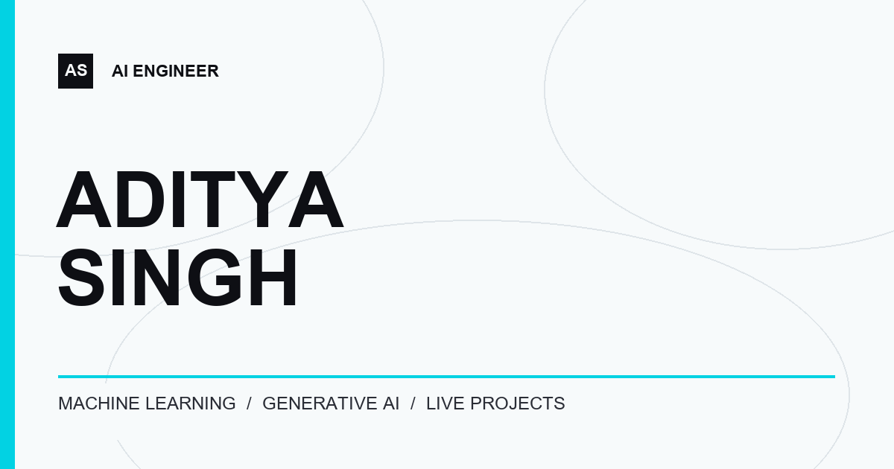

# Aditya Singh — AI Engineer



An interactive portfolio featuring my AI projects, technical skills, certificates, and hackathon work. The site is a static HTML, CSS, and JavaScript project.

**[View the live portfolio](https://aditya-singh-ai-engineer.vercel.app/)** · [Résumé](assets/resume/Aditya-Singh-Resume.pdf) · [LinkedIn](https://www.linkedin.com/in/aditya-singh-7210b2267/)

## Featured projects

| Project | What it does | Links |
| --- | --- | --- |
| **AlphaForage** | Quant research platform for testing trading strategies against costs and unseen data. | [Live demo](https://alpha-forage.vercel.app/) · [Source](https://github.com/ADITYASINGH77770000/AlphaForage) |
| **Finnovix Bot** | Financial analytics and LSTM-based stock-market forecasting. | [Live demo](https://finnovix-bot-4.onrender.com/) · [Source](https://github.com/ADITYASINGH77770000/Finance-Bot) |
| **BrainWave** | AI education tools for code generation, Q&A, summaries, and personalized learning. | [Source](https://github.com/ADITYASINGH77770000/BrainWave) |
| **RainGuard AI** | Flood-risk dashboard combining weather, GIS, satellite analysis, and AI briefings. | [Source](https://github.com/ADITYASINGH77770000/Rain-Guard-AI) · Demo video on the portfolio |
| **Denominator** | Explainable payment-risk monitoring with model scoring and early-warning charts. | [Source](https://github.com/ADITYASINGH77770000/Denominator) · Demo video on the portfolio |

The portfolio also includes a skills section, full-size certificate viewer, and photo albums for hackathon achievements.

## Built with

- HTML, CSS, and JavaScript in [`index.html`](index.html)
- [Three.js](https://threejs.org/) for the animated hero scene
- [Lenis](https://lenis.darkroom.engineering/) for smooth scrolling
- Local images, video, audio, and SVG assets in [`assets/`](assets/)

Three.js, Lenis, and the fonts load from external CDNs. There is no package install or build step.

## Run locally

Clone the repository and serve its root directory over HTTP:

```sh
git clone https://github.com/ADITYASINGH77770000/Aditya-Portfolio.git
cd Aditya-Portfolio
python -m http.server 8765
```

Open [http://localhost:8765](http://localhost:8765). A local server is needed for the site's module imports and asset loading.

## Repository layout

```text
.
├── index.html          # Page markup, styles, and interactions
├── assets/
│   ├── hero/           # Hero textures and image maps
│   ├── projects/       # Project previews and demo videos
│   ├── certs/          # Certificate images
│   ├── wins/           # Hackathon photos and thumbnails
│   ├── resume/         # PDF résumé
│   └── ...             # Logos, icons, audio, and other visuals
├── favicon.svg
├── social-card.png
├── robots.txt
└── sitemap.xml
```

## Deployment

The current public site is hosted on Vercel at [aditya-singh-ai-engineer.vercel.app](https://aditya-singh-ai-engineer.vercel.app/). This Vercel project was deployed directly and is not yet linked to this GitHub repository, so a push to `main` will not automatically update that live URL.
